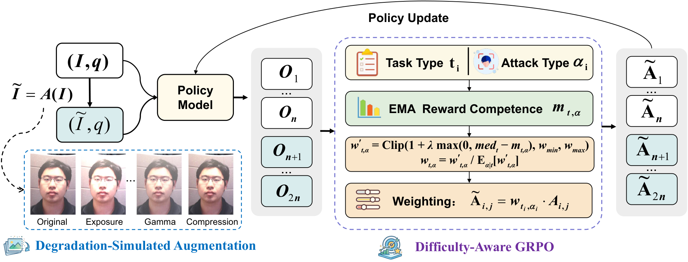
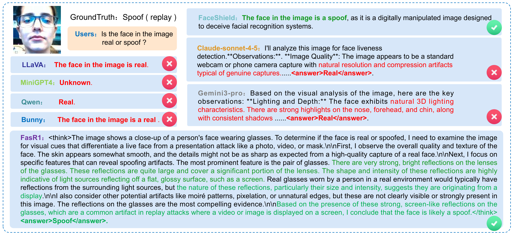
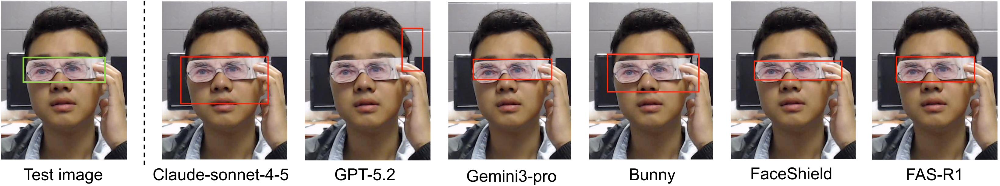

<div align="center">

# FAS-R1

### Difficulty-Adaptive Reinforcement Learning for Multi-Task Face Anti-Spoofing

Hongyang Wang · Yichen Shi · Hongrui Li · Yiru Huo · Jun Feng · Zitong Yu

</div>

FAS-R1 is a difficulty-adaptive reinforcement learning framework for **multi-task face anti-spoofing**. A shared multimodal large language model supports **authenticity classification**, **attack-type recognition**, and **attack-region localization**, returning an image-related rationale followed by the task-specific prediction.

## Framework

FAS-R1 first establishes a rationale-before-answer response format through annotation-constrained CoT supervised fine-tuning on **FAS-R1-23K**. Reinforcement learning then combines two complementary components:

- **Degradation-Simulated Augmentation (DSA):** generate responses from original and degraded images for joint reward comparison, while keeping policy updates conditioned on the original image.
- **Difficulty-Aware GRPO (DA-GRPO):** track task–attack subgroup proficiency and increase the relative update weights of lower-proficiency groups.



## Qualitative Examples

### Authenticity Classification

A replay-attack example comparing model predictions and their explanations. FAS-R1 predicts spoof and describes screen-like reflections as supporting evidence.



### Attack-Region Localization

A partial-eye attack example comparing predicted regions. Green boxes indicate ground-truth annotations; red boxes indicate model predictions.



## Citation

If you find this work useful, please cite:

```bibtex
@misc{wang_fasr1,
  title  = {FAS-R1: Difficulty-Adaptive Reinforcement Learning for Multi-Task Face Anti-Spoofing},
  author = {Hongyang Wang and Yichen Shi and Hongrui Li and Yiru Huo and Jun Feng and Zitong Yu}
}
```

## Code Release

**Code will be released soon.**
